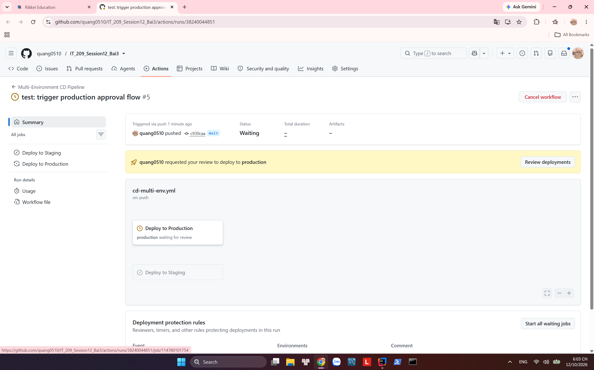

# Bài 3: Tách biệt luồng CI/CD đa môi trường (Staging & Production) với GitHub Environments

## 📌 Báo cáo nộp bài tập

- **Học viên:** Nguyễn Đăng Quang (`quang0510`)
- **Repository:** [https://github.com/quang0510/IT_209_Session12_Bai3](https://github.com/quang0510/IT_209_Session12_Bai3)
- **Đường dẫn thư mục bài nộp:** `homework/session_12/ex3/`

---

## 1. Sản phẩm nộp bài theo yêu cầu đề bài

| STT | Thành phần nộp bài | Vị trí lưu trữ |
|---|---|---|
| 1 | **Tệp kịch bản CI/CD** | [`.github/workflows/cd-multi-env.yml`](.github/workflows/cd-multi-env.yml) và [`homework/session_12/ex3/cd-multi-env.yml`](homework/session_12/ex3/cd-multi-env.yml) |
| 2 | **Ảnh minh chứng phê duyệt Production** | [`homework/session_12/ex3/production-waiting-for-review.png`](homework/session_12/ex3/production-waiting-for-review.png) |

---

## 2. Ảnh chụp màn hình: Cửa sổ phê duyệt deployment môi trường Production

Dưới đây là minh chứng thực tế khi push vào nhánh `main`: Workflow dừng lại tại bước **Deploy to Production** và hiển thị thông báo chờ phê duyệt (**Waiting for review / Required reviewers**):

---

## 3. Cấu hình luồng Pipeline (`cd-multi-env.yml`)

Workflow được thiết kế gồm 2 jobs:
1. **`deploy-staging`**:
   - Điều kiện kích hoạt: Push code vào nhánh `develop` (`if: github.ref == 'refs/heads/develop'`).
   - Môi trường: `environment: staging`.
   - Triển khai tự động không cần phê duyệt.
2. **`deploy-prod`**:
   - Điều kiện kích hoạt: Push code vào nhánh `main` (`if: github.ref == 'refs/heads/main'`).
   - Môi trường: `environment: production`.
   - Bắt buộc phê duyệt qua cơ chế **GitHub Environment Protection Rules (Required reviewers)** trước khi triển khai.
